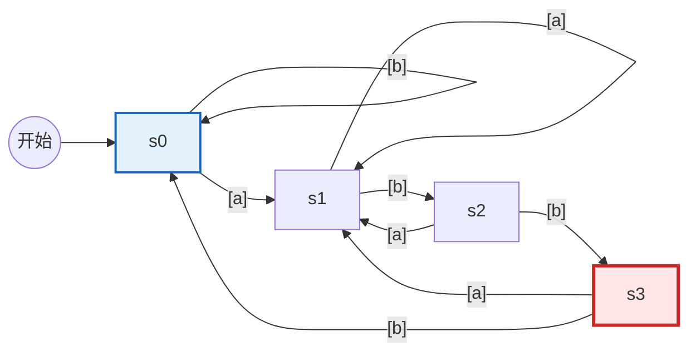

# 06 · 图结构可视化

对应源码：`src/visualize.ts`、`src/cli.ts`。

## 1. 为什么需要可视化

正则的很多困惑不在匹配结果，而在结构：

- `(a|b)*abb` 的 NFA 到底长什么样？
- 为什么子集构造得到 5 个状态，最小化后才是 4 个？
- 某个状态是不是接受状态？哪些边是 ε 边？

文本边列表能查，但不直观。`visualize` 把 AST、NFA、DFA 直接转成图，查看方式有两种：

| 格式 | 查看方式 |
| --- | --- |
| Markdown + Mermaid | 终端输出、VS Code Markdown 预览、GitHub、支持 Mermaid 的编辑器 |
| 独立 HTML | 浏览器直接打开（通过 CDN 加载 Mermaid） |

## 2. 快速使用

```bash
# Markdown 到终端
npm run viz -- '(a|b)*abb'

# 写入文件，然后在 VS Code 中预览
npm run viz -- '(a|b)*abb' --output docs/example.md

# 生成 HTML，默认写入 regex-visualization.html
npm run viz -- '(a|b)*abb' --html

# 指定 HTML 路径
npm run viz -- '(a|b)*abb' --html --output /tmp/regex.html

# 只展示最小化 DFA
npm run viz -- '(a|b)*abb' --min

# 显式打印到终端
npm run viz -- '(a|b)*abb' --html --output -
```

也支持 `-i` / `-m` / `-s` 标志，与匹配命令一致。

## 3. 输出结构

Markdown 依次包含：

1. `## AST`：`flowchart TD`，展示连接、选择、重复层级；
2. `## NFA`：`flowchart LR`，展示 ε 边、字符边、断言边和接受状态；
3. `## DFA（子集构造）`：Mermaid 图 + 转移表；
4. `## DFA（最小化）`：Mermaid 图 + 转移表。

加 `--min` 时只保留第 4 部分。含锚点 `^` / `$` 时跳过 DFA，并给出说明。



（上面就是 `(a|b)*abb` 最小化 DFA 的 Mermaid 源码；支持 Mermaid 的预览器会把它渲染成图。）

## 4. 转义与安全

用户输入的模式可能包含 `[`、`]`、`{`、`}`、`"`、`<`、`&` 等字符，直接塞进 Mermaid 会破坏语法。实现里统一转换为 Mermaid 数字实体：

```
[ → #91;      ] → #93;      { → #123;     } → #125;
| → #124;     " → #quot;    < → #lt;      > → #gt;
```

HTML 模式下，标题与表格内容另外做 HTML 转义；Mermaid 源码本身保留实体写法，避免把 `<br/>` 和实体语法二次转义。

## 5. 布局与限制

- Mermaid 自动布局，适合状态数较少的教学示例；DFA 状态很多时图会变宽，建议改用转移表或 `toDot()`。
- NFA/DFA 图省略指向死状态的转移（`-1`），减少视觉噪音。
- 接受状态用红色粗边框表示，起点状态用蓝色边框表示。
- HTML 依赖 `cdn.jsdelivr.net` 加载 Mermaid；离线环境请使用 Markdown 版本并安装本地 Mermaid 预览插件。

需要精确排版或论文级图片时，仍然可以使用：

```bash
npm run cli -- debug '(a|b)*abb' --dot-nfa --dot-dfa --min
```

把 DOT 输出粘贴到 Graphviz 渲染器即可。

## 6. 扩展

新增 AST 节点或修改 NFA/DFA 结构时：

1. 更新 `src/visualize.ts` 中对应的 `*ToMermaid` 函数；
2. 在 `test/visualize.test.ts` 增加结构断言；
3. 确认 `--min`、锚点跳过、HTML 转义三条路径仍然正常。
